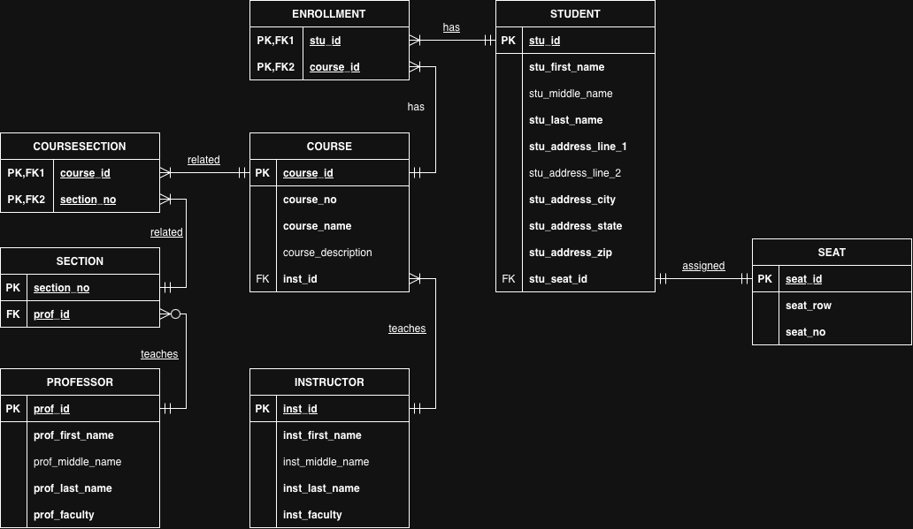

# Lab 2 - Conceptual Modeling using Draw.io
This lab will meet the following course objectives:
1. Determine appropriate entity structure for relational databases

2. Apply the correct terminology to an ER Model

3. Design an ER model

## Instructions
In this lab, you will practice writing business rules that describe the relationships between entities. Using the school ER diagram below, write and recreate a conceptual ER diagram that illustrates the relationships shown.

You will record your relationships within this README file.  When writing down the relationships, follow the bullet points below.
- Entity names are uppercase and bolded
- The connecting verb is underlined
- Bidirectionality of the relationship is represented

Once you complete the README.md file, create an ER Diagram based on the relationships you identified. Create the ER Diagram using a free web-based tool called draw.io.  The shapes you will use to create your ER diagram can be found under the "Entity Relation" tab.  Instructions on how to use draw.io are in the assignment resources section below.

## Requirements

### Deliverable 1 (5 Points)
All relationships are identified, including the relationships that are formed when identifying the new **associative entities**

### Deliverable 2 (5 Points)
Update the ReadMe.md file to reflect the relationships. The relationships adhere to the following bullet points below.
- Entity names are uppercase and bolded
- The connecting verb is <ins>underlined</ins>

- Bi-direction of the relationship is represented

### Deliverable 3 (5 Points)
A conceptual Entity Relationship Diagram(ERD) is created to reflect all entities and relationships identified in the write-up

## Submission Guidelines

For this lab, submit 2 items to the repository.  The two items that you will need to submit are listed below: 
1. The README.MD file that identifies the various Entities and briefly describes each entity, including possible attributes, relationships, and assumptions. 
   1. When identifying relationships, be sure to bold and uppercase the entity name, underline the verb, and make sure relationships are bidirectional. 
   2. When identifying assumptions, make sure to formulate assumptions based on what is represented in the school ERD with either a Yes or No. 
   3. You can override this README.md file that contains the instructions or extend this README.md file by listing your requirements below the lab Resources section.

2. The draw.io XML file that contains your ER Diagram.  You will also need to take a snippet of the ER Diagram and add it as an image in your README file.

Once you complete both items above, submit the link to your repository for lab 2 before the due date and time listed.  

## Lab Resources
- [Mark-down Syntax Cheat Sheet](https://enterprise.github.com/downloads/en/markdown-cheatsheet.pdf)
- [Make a ReadMe file Web-based Editor](https://www.makeareadme.com/)
- [Draw.io Web-based diagramming tool](https://app.diagrams.net/)
- [Creating Entity Relationship Diagrams using Draw.io](https://www.youtube.com/watch?v=lAtCySGDD48)

## Completed Work

### Requirements

#### Entity Descriptions

- **STUDENT** is a person who is enrolled in classes. A student holds a seat when they attend classes.
  - `StudentId`: Unique ID of a student and the Primary Key. This is required and must be unique.
  - `StudentFirstName`: First name of the student. This is required.
  - `StudentMiddleName`: Middle name of the student. This is optional.
  - `StudentLastName`: Last name of the student. This is required.
  - `StudentAddressLine1`: First line of the student address. Usually contains a street number and street. This is required.
  - `StudentAddressLine2`: Second line of a student address. Usually contains an apartment number and is optional.
  - `StudentAddressCity`: City of the student's address. This is required.
  - `StudentAddressState`: State of the student's address. This is required.
  - `StudentAddressZip`: Zip code of the student's address. This is required.
  - `StudentSeatId`: The seat id assigned to the student. A foreign key to **SEAT**.
- **SEAT** is a seat occupied by a student.
  - `SeatId`: Unique ID of a seat and the Primary Key. This is required and must be unique.
  - `SeatRow`: The row the seat is located in. This is required.
  - `SeatNumber`: The number of the seat in the row. This is required.
- **COURSE** is a course a student might take.
  - `CourseId`: Unique ID of a course and the Primary Key. This is required and must be unique.
  - `CourseNumber`: The number of the course. This is required and must be unique.
  - `CourseName`: The course name. This is required.
  - `CourseDescription`: A description of the course. This is optional.
  - `InstructorId`: The id of the course instructor. A foreign key to **INSTRUCTOR**.
- **ENROLLMENT** connects a student to the courses they are enrolled in. 
  - `CourseId`: The course id of the enrollment. This is part of a combo primary key and a foreign key.
  - `StudentId`: The student id of the student who is enrolled. This is part of a combo primary key and a foreign key.
- **INSTRUCTOR** represents an instructor who teaches a course.
  - `InstructorId`: Unique instructor id and the Primary Key. This is required and must be unique.
  - `InstructorFirstName`: First name of the instructor. This is required.
  - `InstructorMiddleName`: Middle name of the instructor. This is optional.
  - `InstructorLastName`: Last name of the instructor. This is required.
  - `InstructorFaculty`: The instructor's faculty. This is required.
- **SECTION** is a teaching section associated with one or more courses.
  - `SectionNumber`: Unique number of a section and the Primary Key. This is required and must be unique.
  - `ProfessorId`: The id of the section professor. A foreign key to **PROFESSOR**.
- **COURSESECTION** connects a course to it's section. 
  - `CourseId`: The course id that is related to the section. This is part of a combo primary key and a foreign key.
  - `SectionNumber`: The section number that is connected to the course. This is part of a combo primary key and a foreign key.
- **PROFESSOR** is a professor who may be assigned to teach sections. Possible attributes include:
  - `ProfessorId`: Unique professor id and the Primary Key. This is required and must be unique.
  - `ProfessorFirstName`: First name of the professor. This is required.
  - `ProfessorMiddleName`: Middle name of the professor. This is optional.
  - `ProfessorLastName`: Last name of the professor. This is required.
  - `ProfessorFaculty`: The professor's faculty. This is required.
  
#### Relationships

- A **STUDENT** is <ins>assigned</ins> exactly one seat; each **SEAT** is <ins>assigned</ins> to exactly one student.
- A **STUDENT** <ins>has</ins> one or more **ENROLLMENT**s; Each **ENROLLMENT** can be assigned to one **STUDENT**.
- A **COURSE** <ins>has</ins> one or more **ENROLLMENT**s; Each **ENROLLMENT** can be assigned to one **COURSE**.
- An **INSTRUCTOR** <ins>teaches</ins> one or more **COURSE**s; Each **COURSE** is <ins>taught</ins> by one **INSTRUCTOR**. 
- A **COURSE** is <ins>related</ins> one or more **COURSESECTION**s; Each **COURSESECTION** can be assigned to one **COURSE**.
- A **SECTION** is <ins>related</ins> one or more **COURSESECTION**s; Each **COURSESECTION** can be assigned to one **SECTION**.
- A **PROFESSOR** <ins>teaches</ins> one or more **SECTION**s; Each **SECTION** is <ins>taught</ins> by one **PROFESSOR**. 

#### Assumptions

- Can a **STUDENT** be in the database without an **ENROLLMENT**? NO
- Can a **STUDENT** be in the database without an assigned **SEAT**? NO
- Can a **SEAT** be assigned to more than one **STUDENT**? NO
- Can a **COURSE** be in the database without an **ENROLLMENT**? NO
- Can a **STUDENT** be enrolled in the same **COURSE** more than once? NO
- Can a **COURSE** be in the database without an **INSTRUCTOR**? NO
- Can a **COURSE** be in the database without a **COURSESECTION**? NO
- Can a **SECTION** be in the database without a **COURSESECTION**? NO
- Can a **PROFESSOR** be in the database without a **SECTION**? YES
- Can a **SECTION** be in the database without a **PROFESSOR**? NO

### Entity Relationship Diagram(ERD)

